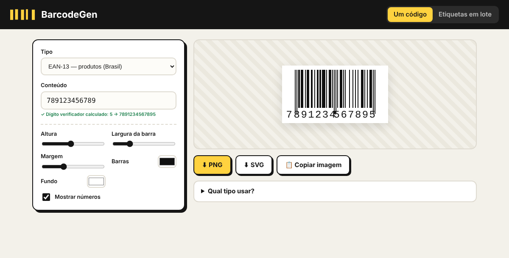

# BarcodeGen — Gerador de código de barras

Gere códigos de barras Code 128, EAN-13, EAN-8 e UPC-A, personalize e baixe em PNG ou SVG, ou imprima etiquetas em lote.

🔗 **[Ver o site no ar](https://iamviniciuslima05.github.io/PROJETO-BarcodeGen/)**



## Funcionalidades

- Codificadores **escritos do zero**: Code 128 (troca automática entre conjuntos B e C), EAN-13, EAN-8 e UPC-A
- **Dígito verificador** calculado ou conferido automaticamente
- Altura, largura das barras, margem, **cores** e números
- Aviso de **pouco contraste**
- Download em **PNG e SVG** e copiar imagem
- **Etiquetas em lote** (um código por linha) prontas para imprimir

## Tecnologias

HTML5 · CSS3 · JavaScript · SVG · Canvas · CSS de impressão

## Estrutura

```
index.html
css/style.css
js/codigos.js  → Code 128, EAN-13, EAN-8, UPC-A
js/script.js   → interface e exportação
```

## Como rodar

Não precisa instalar nada: baixe o projeto e abra o `index.html` no navegador, ou acesse a versão publicada acima.

---
Feito por **Vinicius Lima** · [Portfólio](https://viniciuslimadev.netlify.app) · [LinkedIn](https://www.linkedin.com/in/viniciuslima25/)
